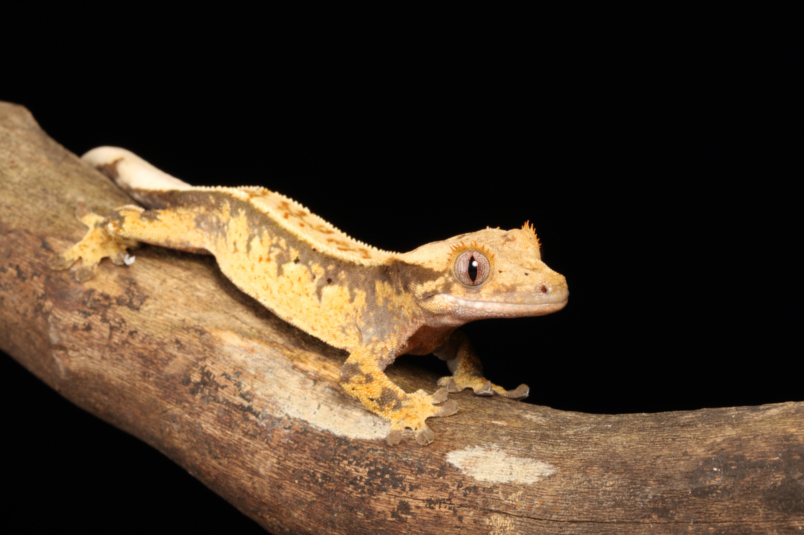
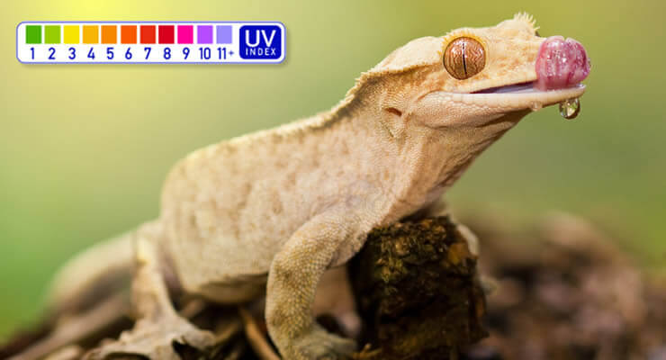

# How Long Do Crested Geckos Live

How long do crested geckos live? In captivity, crested geckos (*Correlophus ciliatus*) typically live **15 to 20 years**, and some reach **25 years or more** with proper care, according to the [Northampton Reptile Centre lifespan guide](https://www.reptilecentre.com/blogs/reptile-blog/how-long-do-crested-geckos-live). This page sums up what affects that figure: diet, heat, humidity, health and breeding.

*Crested geckos are arboreal geckos from New Caledonia.*

## 1. Crested gecko lifespan at a glance

| Setting | Lifespan | Source |
|---|---|---|
| Captivity | Typically 15–20 years; some 25+ | Shop blog |
| Exceptional cases | First known crested geckos surviving well into their 30s | Shop blog |
| Wild | Around 5–15 years | Shop blog |
| "Average life span" | 20 years | [Shop care sheet](https://www.reptilecentre.com/pages/info-crested-gecko-care-sheet) |

> **Note:** the blog and the care sheet word this differently (15–20 years typical vs a 20-year average). Both are shown as published.

## 2. How crested geckos compare

The blog's comparison table, as published:

| Species | Captivity | Wild |
|---|---|---|
| Crested gecko | 15–20 years | 5–15 years |
| Leopard gecko | 10–15 years | 6–8 years |
| House gecko | 5–10 years | 2–5 years |
| Tokay gecko | 8–12 years | 4–7 years |

> The leopard gecko row comes from this crested gecko article. The shop's dedicated leopard gecko article gives 10–20 years in captivity.

## 3. Males, females and breeding

- Females may have slightly shorter lifespans because of egg production.
- Give females rest between breeding cycles.
- Sexual maturity arrives at around 9–12 months.
- If you breed, eggs are incubated at around 29°C.

## 4. Diet for a long life

Crested geckos are omnivores. The blog recommends:

- **80%** powdered crested gecko food
- **10%** live insects: brown crickets, black crickets, locusts and dubia roaches
- **10%** fresh fruit, offered occasionally
- Fresh water in a shallow bowl
- Babies fed daily; adults every other day or 2–3 times a week

## 5. Temperature, humidity and housing

*Mild temperatures and regular misting suit this New Caledonian species.*

- **Day:** 22–26°C; **night:** 18–22°C (blog)
- **Basking area:** around 24°C (75°F); they can become stressed if it gets much warmer (care sheet)
- **Humidity:** 50–70%, misting each evening; they often drink droplets from leaves and walls
- **Enclosure:** a tall glass enclosure with front and top ventilation; at least 45 cm wide for a good gradient (care sheet)
- Heat mat on the outside of a side panel on an on/off thermostat (care sheet)
- Clean the enclosure thoroughly every two weeks

## 6. Growth and size

| Stage | Size / weight |
|---|---|
| Hatchling | 1.5–2 inches; 1–2 g |
| 6 months | 8–15 g |
| Adult | Typically 4–5 inches snout–vent, 7–9 inches with tail; 35–55 g |

## 7. Health problems that shorten lifespan

- Metabolic bone disease (MBD)
- Respiratory infections
- Parasites
- Annual vet checks are recommended

Crested geckos are nocturnal, and regular shedding is normal.

## Further reading

- [How long do crested geckos live – Northampton Reptile Centre blog](https://www.reptilecentre.com/blogs/reptile-blog/how-long-do-crested-geckos-live) (Luke Tansley, 15 Dec 2025)
- [Crested gecko care sheet – Northampton Reptile Centre](https://www.reptilecentre.com/pages/info-crested-gecko-care-sheet)
- [RSPCA: Caring for reptiles and other exotic pets](https://www.rspca.org.uk/adviceandwelfare/pets/other)

---

## About Northampton Reptile Centre

Northampton Reptile Centre is a family-run reptile specialist, founded in 1995.

**Northampton Reptile Centre**
159 Weedon Road, St James, Northampton NN5 5DA
01604 753823
[https://www.reptilecentre.com/](https://www.reptilecentre.com/)
